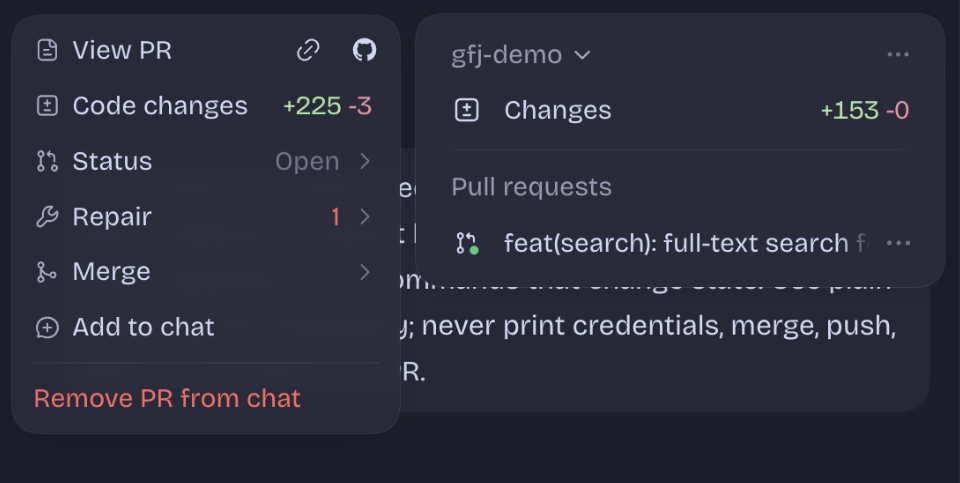
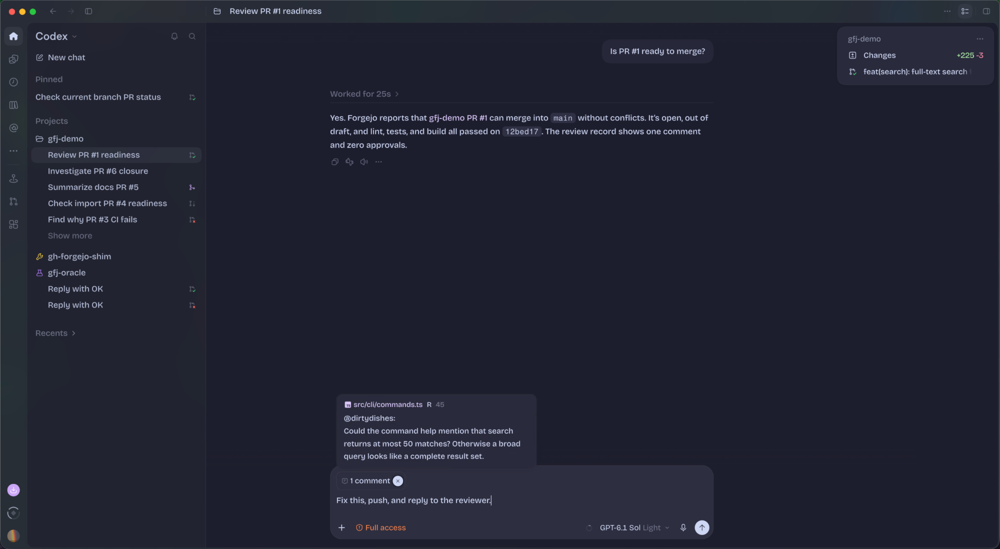

# gh-forgejo-shim

> **Beta.** The shim covers the `gh` calls ChatGPT desktop, Codex and Claude make for day-to-day
> pull request work. A few less common commands aren't covered yet; [Known gaps](#known-gaps) lists
> them. If something breaks, please
> [open an issue](https://github.com/dirtydishes/gh-forgejo-shim/issues/new). Say which app you
> were using and which action you were attempting, and paste the output of `gfj doctor`. To show us
> the exact commands, turn on [tracing](#codex-probe-diagnostics) and attach the trace, but read it
> first: redaction hides most credentials, not every form. [Rollback](#rollback) removes only the
> shim's own files.

Open a Forgejo repository in Codex, in the ChatGPT desktop app, and its pull requests work as they
do on GitHub. The shim answers the GitHub CLI (`gh`) calls these apps make with data from your Forgejo
server, and leaves your GitHub repositories to the real `gh`.


## What works

In a Forgejo repository, Codex in ChatGPT desktop gives you:

- A pull request status icon beside each chat in the sidebar.
- The pull request menu: view the PR, its code changes and status, repair, and merge.
- Review comments: add a reviewer's comment to the chat and tell the agent to deal with it.
- The agent's own `gh` calls, so it can read checks, post comments and tell whether a PR is ready
  to merge.





## Works with

| App | PR status | CI checks | Merge | Issues | Mode |
|---|---|---|---|---|---|
| ChatGPT desktop (Codex in the app) | yes, except the overview pane | yes | untested | untested | either |
| Codex CLI | yes | yes | untested | untested | either |
| Claude Code | API tested | untested | untested | untested | server mode |
| Claude desktop | yes | yes | untested | untested | server mode |
| GitHub Copilot CLI | untested | untested | untested | untested | either |
| Cursor's agent ([#242](https://github.com/dirtydishes/gh-forgejo-shim/issues/242)) | untested | untested | untested | untested | either |
| [Other agents that can run `gh`](docs/apps.md#agents-that-can-run-gh) | untested | untested | untested | untested | either |

[docs/apps.md](docs/apps.md) covers more apps: editors, tools that speak Forgejo themselves and may
not need the shim, and cloud features it can't reach.

Using an app that isn't listed, or marked untested? Tell us how it went in
[#271](https://github.com/dirtydishes/gh-forgejo-shim/issues/271).

"Yes" means it has been run in the app. "API tested" means CI sends the app's own requests to the
gateway, but no run in the app is on record. "Either" means client-only or server mode. In
client-only mode, Claude's agent can still run `gh` itself, once you
[tell it to](#tell-claudes-agent-to-use-gh). [Known gaps](#known-gaps) lists what doesn't work yet.

## Contents

- [Works with](#works-with)
- [Two ways to run it](#two-ways-to-run-it)
- [Install](#install) and [Quickstart](#quickstart)
- [Server mode](#server-mode) and [pull request links](#pull-request-links)
- [Known gaps](#known-gaps)
- [Usage reports](#usage-reports)
- When something breaks: [Doctor](#doctor), [Codex probe diagnostics](#codex-probe-diagnostics),
  [Rollback](#rollback)
- [Reference](#reference): commands and JSON output, configuration and auth, setup details
- [Development](#development)

## Two ways to run it

- **Client-only:** the `gh` wrapper on each machine. Each `gh` call in a Forgejo repository starts a
  private gateway for that call alone, and nothing changes on the forge. It covers Codex and any
  agent or tool that runs `gh`.
- **Server mode (new in 0.2.0):** the gateway, `fga-server`, runs beside Forgejo on the forge's own
  hostname, so the forge itself answers GitHub's API. Any `gh` logged in to the forge works with no
  wrapper, and so do tools that call the API without `gh`. **Use it if you use Claude Code or Claude
  desktop:** they look up a branch's pull request themselves, outside `gh`, and only a gateway on the
  forge can answer. It needs control of the forge's reverse proxy.

You can use both. [Server mode](#server-mode), further down, has the setup.

## Install

### Requirements

The `gh` wrapper runs the real GitHub CLI, so it needs `gh` 2.103.3 or newer. `gfj bootstrap` and `gfj install-shim` stop without changing anything when the `gh` they find is missing or older, and `gfj doctor` reports the same check. Many distributions ship an older `gh`; on Ubuntu and Debian, add GitHub's own apt repository as [gh's Linux install guide](https://github.com/cli/cli/blob/trunk/docs/install_linux.md) shows, or use Homebrew. A `gh` you built yourself that reports `DEV` needs `FJ_SHIM_ALLOW_UNKNOWN_GH=1`. See [docs/installation.md](docs/installation.md#requirements).

### Install with an agent

Paste this into Claude Code, Codex or another coding agent, opened in your Forgejo repository:

```text
Install gh-forgejo-shim for me. Follow the steps at
https://raw.githubusercontent.com/dirtydishes/gh-forgejo-shim/v0.6.0/docs/agent-install.md
and never ask me to paste a token into the chat.
```

It asks which apps you use, installs and sets up the wrapper, logs it in and checks server mode.
If the agent can ask you for a secret, it passes your token to the login command itself; if not,
it gives you the command to run. It changes nothing on your forge's server.
[docs/agent-install.md](docs/agent-install.md) has the steps it follows.

### Install paths

The steps below set up the client-only wrapper. For server mode, see
[Server mode](#server-mode).

Install the native Rust binary with Homebrew:

```sh
brew install dirtydishes/tap/gh-forgejo-shim
gfj --version
```

It sends one anonymous [usage report](#usage-reports) a day, so I can see which agents run into missing or failing features. `gfj telemetry show` prints it, and `gfj telemetry off` stops it.

Release tarballs for macOS and Linux, checksums and upgrades: [docs/installation.md](docs/installation.md).
Coming from the old pipx install: [docs/pipx-to-rust-migration.md](docs/pipx-to-rust-migration.md).
PyPI is not a supported product runtime.

## Quickstart

1. Install the native package with Homebrew or a GitHub release tarball.
2. Open a terminal inside your Forgejo repository.
3. Run `gfj bootstrap`.
4. Run `gfj auth login HOST` with a token that has the [four scopes](#token-scopes), or use `gfj auth import --from fj|tea --hostname HOST` to copy a token from that tool's config.
5. Copy and run any repair commands `bootstrap` prints.
6. On macOS, restart the GUI tool if `bootstrap` reports that it changed the GUI PATH.
7. Confirm the setup:

```sh
gfj doctor
```

8. Restart the GUI tool, open the Forgejo repository, and use the normal repository, branch, commit, push, pull request, issue, and check workflows.

`bootstrap` adds the repository's host to the allowlist, installs the managed `gh` wrapper, and on
macOS updates the PATH that apps opened from Finder, Dock or Spotlight get. It checks the real
`gh`'s version before it writes anything, and prints repair commands for anything it can't fix.
[docs/installation.md](docs/installation.md#first-setup) lists each step and its flags
(`--force`, `--dry-run`, `--target user-local`, `--no-gui-path`), and
[how to set up by hand](docs/installation.md#manual-setup).

For scripted setup or documentation, use `gh-forgejo-shim`. For day-to-day typing, `gfj` is the same command with a shorter name.

### Token scopes

Create the Forgejo token under **Settings → Applications** with these four scopes. The wrapper and server mode need the same ones. In Forgejo a `write:` scope includes its `read:` scope, so a token with these four needs no other.

| Scope | Without it |
|---|---|
| `read:user` | Every gh call fails, since the gateway can't tell whose token it is. |
| `write:repository` | Pull requests, branches and checks can't be read. With `read:repository` only, pull requests can't be created, edited or merged. |
| `write:issue` | Issues can't be read, and a pull request's comments and scheduled auto-merge read as none. With `read:issue` only, issues and comments can't be created or edited. |
| `read:organization` | A repository an organization owns reads as owned by a user. |

`gfj doctor` names any scope a host's token lacks. [docs/configuration.md](docs/configuration.md#auth)
says what the gateway logs when a missing scope hides data.

## Server mode

![Claude desktop's Code tab on a Forgejo repository named gfj-demo, branch feat/full-text-search. Asked "Is PR #1 ready to merge?", the agent answers that it can merge: no conflicts, and lint, test and build passed on commit 12bed17. Still open is a review comment on src/cli/commands.ts line 45 asking the search help to mention the 50-match cap, which the code sets at src/db/bookmarks.ts line 58. The right panel lists PR #1, "feat(search): full-text search for …", +225 −3, with one comment and a green CI dot.](docs/images/claude-pr-ready.png)

**You need:**

- your own Forgejo;
- a reverse proxy in front of it that you control (nginx, Caddy or Nginx Proxy Manager); a hosted
  forge such as Codeberg can't use server mode;
- Docker with Compose, on a machine that can reach Forgejo.

**Set it up:**

1. Copy [packaging/gateway/compose.yaml](packaging/gateway/compose.yaml) into a folder of its own.
2. In it, set `FGA_PUBLIC_URL` to the forge's address as users type it, `FGA_FORGEJO_URL` to how the
   gateway reaches Forgejo, and the network name to the Docker network Forgejo and the proxy share.
   If they don't share one yet, [server-mode.md](docs/gateway/server-mode.md#1-run-the-gateway) shows
   how to create one and attach them.
3. In that folder, run `docker compose up -d`. It pulls the published image,
   `ghcr.io/dirtydishes/fga-server`.
4. Route three paths on the forge's hostname to `fga-server:8080`, and everything else to Forgejo as
   before: `/api/v3/`, `/api/graphql`, and `/{owner}/{repo}/pull/{n}` (GitHub-style pull request
   links, which the gateway redirects to Forgejo's `/pulls/{n}`). Pass the client's `Host` header
   through unchanged. [docs/gateway/server-mode.md](docs/gateway/server-mode.md) has the nginx, Caddy
   and Nginx Proxy Manager steps.
5. Check it. Without a token the API answers `401`; `421` means the proxy changed `Host`. A pull
   request link redirects to Forgejo's page:

   ```sh
   curl -s -o /dev/null -w '%{http_code}\n' https://forge.example.com/api/v3/meta
   curl -s -o /dev/null -w '%{http_code} %{redirect_url}\n' https://forge.example.com/<owner>/<repo>/pull/1
   ```

6. Log in. gh's browser login doesn't work with Forgejo, so create a token in Forgejo under
   **Settings → Applications** with the [four scopes](#token-scopes), run
   `gh auth login --hostname forge.example.com`, and paste it. Claude and ChatGPT desktop take their
   token from `gh`.

### Tell Claude's agent to use `gh`

In testing, Claude desktop's agent saw the Forgejo remote, assumed `gh` only works with GitHub, and
used `curl` instead. Codex used `gh` without help. Two lines in your repository's `CLAUDE.md` fixed it:

```text
`gh` works in this repository through gh-forgejo-shim. Use it for pull requests, checks, reviews and comments.
Pass `--hostname <your forge host>` to every `gh api` call; without it, `gh api` can go to github.com.
```

The gateway keeps no state but two dates for its [usage report](docs/telemetry.md). To upgrade or roll back, change the image tag in `compose.yaml` and run
`docker compose up -d` again. [server-mode.md](docs/gateway/server-mode.md#1-run-the-gateway) also
shows how to build the image yourself.

## Pull request links

The wrapper and the gateway print pull request links in GitHub's `/pull/7` layout, which Forgejo
doesn't serve. Server mode redirects them; for client-only installs, add the redirect in
[docs/pull-request-links.md](docs/pull-request-links.md) to the forge's reverse proxy.

## Known gaps

- `gh run view --log` and `--log-failed` fail with a 404: the gateway doesn't serve job logs yet
  ([#161](https://github.com/dirtydishes/gh-forgejo-shim/issues/161)).
- Some `gh repo view --json` fields and some `gh api` routes aren't served by the gateway yet
  ([#189](https://github.com/dirtydishes/gh-forgejo-shim/issues/189)).
- In server mode without the wrapper, a `gh api` call with no `--hostname` goes to github.com when
  gh is also logged in there; that's how gh picks a host. Agents run such calls, so install the
  wrapper too, or tell the agent to pass `--hostname`
  ([#265](https://github.com/dirtydishes/gh-forgejo-shim/issues/265)). The second line of the
  [`CLAUDE.md` tip](#tell-claudes-agent-to-use-gh) does that for Claude.
- ChatGPT desktop's pull request overview pane needs a GitHub account connected to ChatGPT and
  can't open a Forgejo pull request. That's how ChatGPT is built, not a shim bug. The sidebar
  status, the pull request menu, review comments and the agent's `gh` commands work.
- In a Forgejo checkout, `gh pr create` checks where git will push before it runs. The check is best
  effort: a few unusual git or SSH setups can still send the push to another host
  ([#255](https://github.com/dirtydishes/gh-forgejo-shim/issues/255)).

## Doctor

Run `gfj doctor`. It checks `gh` and its version, the wrapper, the allowlisted hosts, the token and
its [scopes](#token-scopes), and on macOS the GUI PATH. [docs/installation.md](docs/installation.md#doctor)
lists every check.

## Codex probe diagnostics

Set `FJ_SHIM_TRACE` to a file path, and `FJ_SHIM_TRACE_BODY=1` for redacted excerpts, to record each
`gh` command the shim handles or delegates. Read a trace before you share it. [docs/tracing.md](docs/tracing.md) has
the commands, what redaction hides, and the smoke probes.

## Usage reports

To find what breaks in agents and forges I can't test myself, gh-forgejo-shim and fga-server
send one anonymous report a day: the version, OS and arch, mode,
which agent ran gh, the forge's software and major version, gh's version, the week of the first
report, and the GitHub names the gateway lacked or failed, under the agent that asked. No hosts, repositories, commands or IDs. The report goes in the background and never slows or changes a `gh` call; a call that hit a missing or failing feature takes a few milliseconds to note which agent ran it. Turn it off with
`gfj telemetry off`, `GFJ_TELEMETRY=0` or `DO_NOT_TRACK=1` (`FGA_TELEMETRY=0` for fga-server), and
see the report with `gfj telemetry show`. [docs/telemetry.md](docs/telemetry.md) lists every
field, what the collector keeps, and what it publishes: rounded weekly totals.

## Rollback

`gfj uninstall-shim` removes the wrapper and `gfj uninstall-gui-path` the macOS LaunchAgent;
`gfj auth logout HOST` removes stored auth. Each touches only the shim's own files.
[docs/rollback.md](docs/rollback.md) has every step.

## Reference

- [Commands and output](docs/commands.md): which `gh` commands the shim routes, the flags it
  supports for pull requests and issues, how it maps Forgejo statuses to checks, and the JSON
  fields it returns.
- [Configuration](docs/configuration.md): `config.toml` and each host's keys, environment
  variables, auth storage and token lookup, private CA certificates, and the macOS GUI PATH.
- [Installation](docs/installation.md): release archives, what `bootstrap` does, manual setup,
  the doctor checks, the remote layout tools expect, upgrading and rolling back.
- [Tracing](docs/tracing.md): trace records, redaction, smoke probes and the `git` recorder.
- [Server mode in depth](docs/gateway/server-mode.md): proxy setup for nginx, Caddy and Nginx Proxy
  Manager.

## Development

Build, test and release steps are in [CONTRIBUTING.md](CONTRIBUTING.md).
